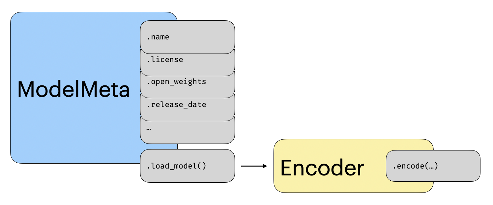

# Models

A model in `mteb` covers two concepts: metadata and implementation.
- Metadata contains information about the model such as maximum input
length, valid frameworks, license, and degree of openness.
- Implementation is a reproducible workflow, which allows others to run the same model again, using the same prompts, hyperparameters, aggregation strategies, etc.

<figure markdown="span">
    { width="80%" }
    <figcaption>An overview of the model and its metadata within `mteb`</figcaption>
</figure>


## Utilities

:::mteb.get_model_metas

:::mteb.get_model_meta

:::mteb.get_model


## Metadata

:::mteb.models.model_meta.ModelMeta

## Model Protocols

:::mteb.models.EncoderProtocol

:::mteb.models.SearchProtocol

:::mteb.models.CrossEncoderProtocol

:::mteb.models.MTEBModels


## Cache Wrappers

:::mteb.models.CachedEmbeddingWrapper

:::mteb.models.cache_wrappers.CacheBackendProtocol

:::mteb.models.cache_wrappers.cache_backends.NumpyCache

:::mteb.models.cache_wrappers.cache_backends.FaissCache


## Compression Wrapper

:::mteb.models.CompressionWrapper

## Video2Images Wrapper

:::mteb.models.Video2ImagesWrapper


## Modality Filter Wrapper

Use `ModalityFilterWrapper` to evaluate the same retrieval or reranking task with
selected query or corpus inputs. Each explicit selection is saved as a separate
experiment in the result cache.

```python
import mteb
from mteb.models import ModalityFilterWrapper

model = mteb.get_model("nvidia/Nemotron-3.5-Embed-1B-BF16")
task = mteb.get_task("Vidore3HrRetrieval.v2", hf_subsets=["english"])
for modalities in (["text"], ["image"], ["text", "image"]):
    selected = ModalityFilterWrapper(model, corpus_modalities=modalities)
    mteb.evaluate(selected, task)
```

`query_modalities` selects query inputs independently. Omit a side to retain its
existing behavior; explicit selections must be nonempty and available on that
side. An image-only corpus still receives text queries in this example. The
wrapper filters supplied content; it does not run OCR or force a model to use
all retained modalities.

The wrapper supports custom `SearchProtocol` implementations that honor the
supplied datasets, plus encoders and cross-encoders adapted through MTEB's search
wrappers. It exposes only `SearchProtocol`. Built-in embedding caches inside the
wrapped search use the modality configuration for cache identity, including when
search delegates to worker threads with the effective task metadata. Nested
modality wrappers, an embedding cache outside the search-only wrapper, and
`SearchEncoderWrapper` with an append-only index backend are unsupported.
External/private indexes and caches remain the search implementation's
responsibility. Use separate model instances for concurrent evaluations.

The normalized selection is recorded in `ModelMeta.experiment_kwargs`, preserving
other experiment settings and the base model's supported modalities. Loading the
saved model metadata recreates the wrapper. The same options can be passed to
`mteb.get_model(..., corpus_modalities=["image"])`.

:::mteb.models.ModalityFilterWrapper


## Search Index Backends

:::mteb.models.search_encoder_index.search_backend_protocol.IndexEncoderSearchProtocol

:::mteb.models.search_encoder_index.search_indexes.faiss_search_index.FaissSearchIndex
